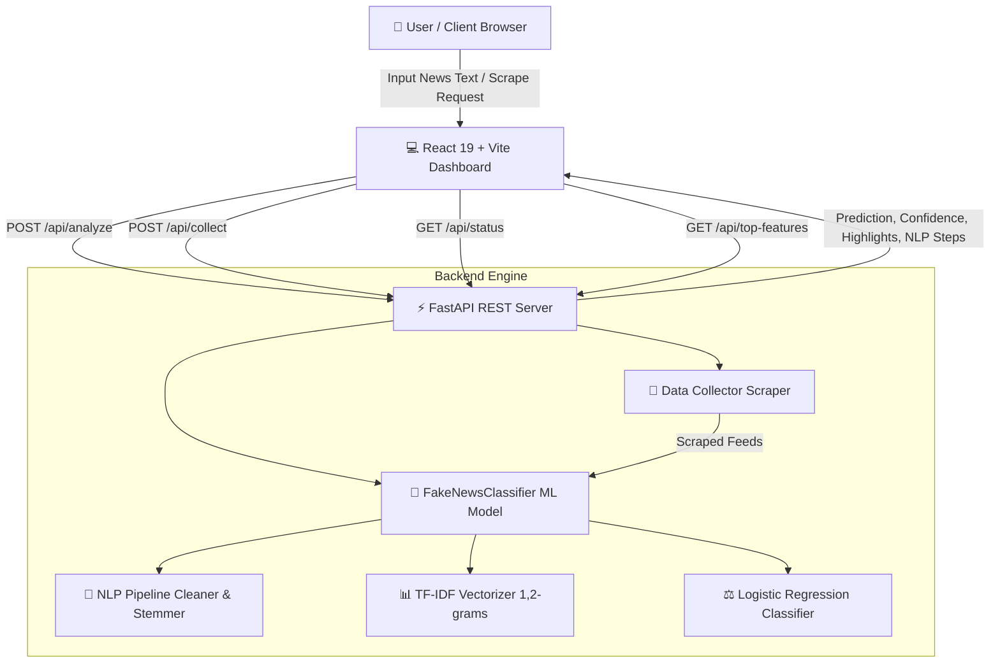

# 🛡️ VeriTrust — AI-Powered Social Media Verification & Fake News Classifier

[](https://www.python.org/)
[](https://fastapi.tiangolo.com/)
[](https://react.dev/)
[](https://vitejs.dev/)
[](https://scikit-learn.org/)
[](LICENSE)
[](https://github.com/gkm563/VeriTrust/pulls)

**VeriTrust** is a state-of-the-art, AI-powered web platform for real-time fake news detection, social media content verification, and lexical feature explainability. Built with a high-performance **FastAPI** backend and a sleek **React + Vite** frontend, VeriTrust leverages **Natural Language Processing (NLP)**, **TF-IDF n-gram vectorization**, and **Logistic Regression** to analyze news headlines, posts, and articles with high precision and explainable AI insights.

---

## 📌 Table of Contents
- [✨ Key Features](#-key-features)
- [🏗️ System Architecture](#️-system-architecture)
- [🛠️ Tech Stack](#️-tech-stack)
- [⚡ Quick Start & Installation](#-quick-start--installation)
  - [1. Prerequisites](#1-prerequisites)
  - [2. Backend Setup (FastAPI)](#2-backend-setup-fastapi)
  - [3. Frontend Setup (React + Vite)](#3-frontend-setup-react--vite)
- [📡 API Documentation](#-api-documentation)
- [🔬 Machine Learning & NLP Pipeline](#-machine-learning--nlp-pipeline)
- [🤝 Contributing](#-contributing)
- [📄 License](#-license)

---

## ✨ Key Features

- 🎯 **Real-Time Machine Learning Verdict**: Classifies input social media posts and headlines into **Real** vs. **Fake** with instant confidence scoring.
- 🎨 **Lexical Feature Highlighter**: Highlights individual words in real-time, displaying green overlays for **Real Signals** (positive weights) and red overlays for **Fake Signals** (negative weights).
- 🔬 **Intermediate NLP Pipeline Inspector**: Visualizes step-by-step transformations:
  - `Raw Input` → `Cleaned Text` → `Tokenization` → `Stopwords Removal` → `Rule-based Stemming`.
- 📊 **Clickbait & Metric Indicators**: Evaluates clickbait markers, uppercase emphasis ratios, exclamation mark density, and character metrics.
- ⚡ **Live Data Ingestion & Model Retraining**: Interactively scrape simulated **Twitter/X feeds**, **Reddit threads**, and **Local CSV datasets**, triggering immediate dataset expansion and model retraining on demand.
- 📈 **Feature Importance Explorer**: Inspects top global indicators learned by the model for real and fake news detection.
- 💎 **Modern Dark Glassmorphism UI**: Built with a responsive dark-mode design system, dynamic animations, and interactive SVG gauge charts.

---

## 🏗️ System Architecture



---

## 🛠️ Tech Stack

### **Backend Framework & Machine Learning**
- **Python 3.12+**: Modern asynchronous core.
- **FastAPI & Uvicorn**: High-performance RESTful API microservice architecture.
- **Scikit-Learn**: Machine learning library powering `TfidfVectorizer` and `LogisticRegression`.
- **Pandas & NumPy**: Efficient array manipulation and dataframe preprocessing.
- **Pydantic**: Strict data validation for API requests.

### **Frontend Interface**
- **React 19**: Modern UI framework.
- **Vite 8**: Next-generation frontend build tooling.
- **Vanilla CSS3**: Design system with glassmorphism, flex/grid layouts, and dark mode tokens.

---

## ⚡ Quick Start & Installation

### 1. Prerequisites
- **Python 3.10+** (Python 3.12 recommended)
- **Node.js 18+** and `npm`

### 2. Backend Setup (FastAPI)

1. Navigate to the backend directory:
   ```bash
   cd backend
   ```

2. Create and activate a virtual environment:
   ```bash
   # Windows
   python -m venv venv
   venv\Scripts\activate

   # macOS / Linux
   python3 -m venv venv
   source venv/bin/activate
   ```

3. Install required Python packages:
   ```bash
   pip install -r requirements.txt
   ```

4. Run the FastAPI development server:
   ```bash
   python main.py
   ```
   *The server will start at `http://127.0.0.1:8000`.*

5. Run automated backend verification test suite:
   ```bash
   python verify_model.py
   ```

---

### 3. Frontend Setup (React + Vite)

1. Open a new terminal and navigate to the frontend directory:
   ```bash
   cd frontend
   ```

2. Install Node dependencies:
   ```bash
   npm install
   ```

3. Start the Vite development server:
   ```bash
   npm run dev
   ```
   *The frontend dashboard will be live at `http://localhost:5173`.*

---

## 📡 API Documentation

VeriTrust exposes clean RESTful endpoints:

| Method | Endpoint | Description | Payload Example |
| :--- | :--- | :--- | :--- |
| `POST` | `/api/analyze` | Analyzes input text for credibility, returns verdict, confidence, highlight contributions, and NLP steps. | `{"text": "Headline or article body..."}` |
| `POST` | `/api/collect` | Ingests dataset from simulated feeds (`Twitter`, `Reddit`, `LocalFiles`) and retrains the model. | `{"source": "Twitter"}` |
| `GET` | `/api/status` | Returns system status, model training state, sample count, and training accuracy. | *None* |
| `GET` | `/api/top-features` | Retrieves top lexical indicators for Real and Fake news. | `?limit=15` |

---

## 🔬 Machine Learning & NLP Pipeline

The classification model uses a robust, interpretable Machine Learning workflow:

1. **Preprocessing & Cleaning**: Strips special noise characters while retaining punctuation markers (`!`, `?`) indicative of clickbait.
2. **N-Gram TF-IDF Vectorization**: Extract unigram and bigram features (`ngram_range=(1, 2)`) with English stopword filtering.
3. **Logistic Regression Classifier**: Trained with `C=1.5` regularization for balanced generalizability and high accuracy.
4. **Local Feature Attribution**: Extracts matrix row coefficients (`col_val * coefficient`) to compute exact token impact scores for explainability.

---

## 🤝 Contributing

Contributions, issues, and feature requests are welcome!
1. Fork the Repository
2. Create a Feature Branch (`git checkout -b feature/AmazingFeature`)
3. Commit Changes (`git commit -m 'feat: Add AmazingFeature'`)
4. Push to Branch (`git push origin feature/AmazingFeature`)
5. Open a Pull Request

---

## 📄 License

Distributed under the **MIT License**. See `LICENSE` for more information.

Developed with ❤️ by [GKM](https://github.com/gkm563).
